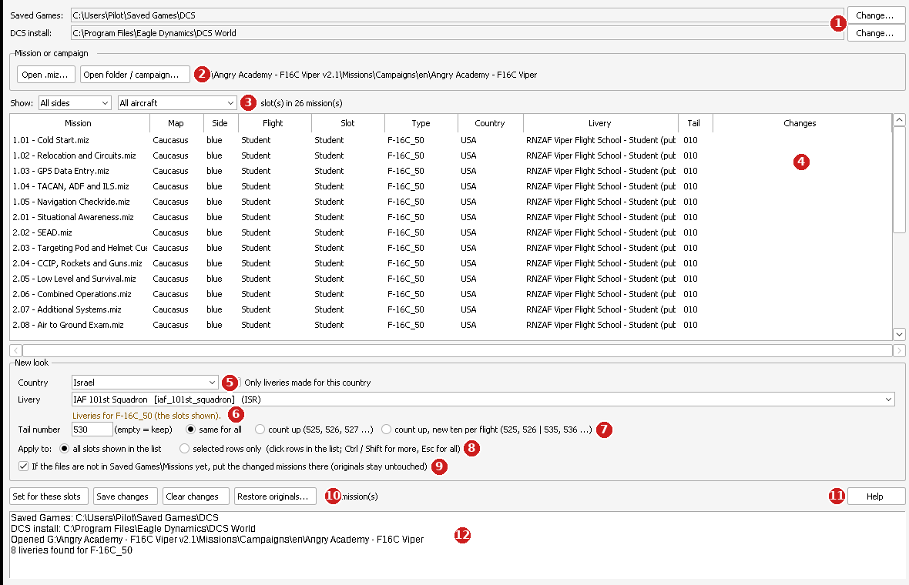

# DCS Livery Changer

**Fly every mission in your own country's colours.**

How many times have you downloaded a great DCS mission or campaign and wished you could fly it with your country's
markings or your favourite squadron skin? How many times have you joined a multiplayer server and found that the
skins don't match the region? DCS Livery Changer fixes that in a few clicks, without the Mission Editor.

## Download

Get **DCS Livery Changer** from the [**Releases**](../../releases/latest) page: download the zip, unzip it and run
`DCS Livery Changer.exe`. No installation needed. Windows 10 or 11.

The zip also holds the full user guide (PDF). The program has built-in help too (F1).

> Windows SmartScreen may warn about a new program: click **More info** and then **Run anyway**.

## What it does

- Changes the **country**, **livery** and **tail number** of the aircraft people fly:
  the player aircraft in single-player missions and campaigns, and every Client slot in multiplayer missions.
- Works on one `.miz` file or a whole folder / campaign at once.
- Shows only the countries the mission maker put on that side (blue or red), or any DCS country if you want.
- Lists the liveries installed in your Saved Games folder and your DCS install.
- Tail numbers: the same for all, counting up, or a new ten per flight (525, 526 | 535, 536 ...).
- Different aircraft types and flights can each get their own look, then everything is saved in one go.
- **Your originals are always kept** in a `_livery_backup` folder, and *Restore originals* puts them back.
- File names never change, so campaign progress is kept.

## How to use it

1. On the first run, point it to your DCS Saved Games folder and your DCS install folder.
2. **Open .miz...** for one mission, or **Open folder / campaign...** for a folder.
3. Pick a **Country**, a **Livery** and/or a **Tail number**.
4. For multiplayer missions, filter by side and aircraft type, or click rows, and press **Set for these slots**.
5. Press **Save changes**.

## Feedback

Bugs and ideas: open an [issue](../../issues) or email **simflightacademy@gmail.com**.

## License

© 2026 4X ASF. All rights reserved. Free to use and share unchanged for personal use. See [LICENSE](LICENSE).

DCS World is a trademark of Eagle Dynamics SA. This program is not affiliated with or endorsed by Eagle Dynamics.
